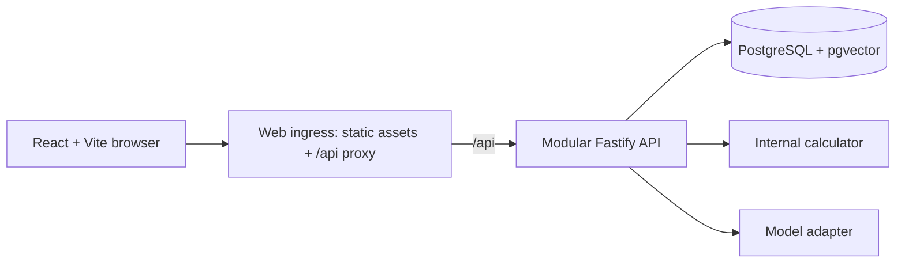

# Architecture Spine — Policy Endorsement Assistant

## Design Paradigm

One modular Fastify API owns customer workflows and state. Its domain modules depend on declared ports for storage, vector retrieval, model assessment, and calculation. React is a client of the API; the deterministic calculator is a separate internal service.



## Invariants & Rules

### AD-1 — One public workflow owner [ADOPTED]

- **Binds:** R1–R8; all feature epics.
- **Prevents:** Independent web, retrieval, or decision implementations claiming authority over the same customer workflow.
- **Rule:** Fastify owns the public API, authorization, workflow decisions, and writes. The web ingress serves Vite's static assets and routes same-origin `/api` requests to Fastify. The calculator, database, and model adapter have no browser-facing endpoint. Domain modules cannot import transport or persistence adapters.

### AD-2 — Server-owned identity and policy access [ADOPTED]

- **Binds:** R1–R4, R7.
- **Prevents:** Client-provided identity, stale browser state, or an unauthorized policy reaching retrieval or decision tools.
- **Rule:** The API issues opaque, database-backed sessions through `HttpOnly` cookies, invalidates them on logout, and derives the actor on every protected call. It checks ownership before every protected read, write, retrieval, proposal review, or decision and requires `ACTIVE` status before an endorsement request; an owned expired policy remains viewable. Set `Secure` under HTTPS, explicitly set `SameSite`, and enforce CSRF protection on every cookie-authenticated state-changing route.

### AD-3 — Single transactional owner for non-binding state [ADOPTED]

- **Binds:** R2, R6–R8.
- **Prevents:** One epic changing policy data while another treats proposals as non-binding, or losing an audit event for a committed decision.
- **Rule:** Fastify is the only database client. Within it, auth owns sessions, request owns requests, assessment owns immutable evidence snapshots, proposal owns proposal creation and the decision transition, and audit owns append-only events; other modules use their declared interfaces. Seeded policy records are read-only to the endorsement workflow. A state mutation and its audit event commit in one transaction. A proposal has at most one final decision, enforced by a database uniqueness constraint and an atomic pending-to-decided transition; a retry with the same idempotency key returns the recorded result. Before approval, recheck the proposal snapshot's owner, policy `ACTIVE` status and revision, source effectiveness, and quote validity; if any changed, block approval and require reassessment. Rejection may still be recorded for the owned pending proposal. Approval records the customer's decision and proposed values in history; it never changes policy or coverage.

### AD-4 — Authorized, versioned evidence before model assessment [ADOPTED]

- **Binds:** R2–R6.
- **Prevents:** Cross-account evidence, wrong-product rules, stale passages, or unsupported model output authorizing a proposal.
- **Rule:** For endorsement assessment, after ownership and active-status checks, the API filters versioned policy wording and rules by authorized policy, product, change type, and effective date before vector ranking; read-only detail retrieval of an owned expired policy does not require active status. It sends only bounded authorized passages to the model. The model returns a tentative status, customer-readable reason, separate support claims for **both** policy wording and rules, and exact cited spans. The API checks the spans against the authorized immutable source snapshot, verifies versions, required inputs, and machine-readable rule predicates, and rejects citation presence alone as proof of support. Unclear policy meaning, missing, stale, or conflicting evidence yields `NEEDS_REVIEW` with unresolved items; ineligibility yields `CANNOT_PROCEED`. An unavailable dependency returns a visible failure. None of these paths may call calculation or create a proposal. The rider flow does not collect or assess medical evidence and discloses that real coverage may need further review.

### AD-5 — Calculator owns authoritative quote values [ADOPTED]

- **Binds:** R5–R6, R8.
- **Prevents:** Model or browser arithmetic, inconsistent rating versions, or quote calls for rejected requests.
- **Rule:** Only the API calls the separate internal calculator after validated eligibility **and** only when premium or benefits change. The API sends a versioned, minimal quote input derived from the immutable policy/change/assessment snapshot; the calculator owns versioned synthetic rating tables, validates the currency and input units, and returns a versioned response with signed base-10 integer strings in ISO 4217 minor units and a currency code. The calculator applies its versioned rating and rounding rules before returning minor units; the API does not round or recalculate. The API rejects a response with mismatched snapshot, currency, or rating version and records accepted values with the exact policy, evidence, and rating versions used. When no calculation is needed, the proposal states the relevant values are unchanged. Every proposal retains its supporting policy and rule citations. The calculator cannot read customer records or modify policies.

### AD-6 — Provider-owned HTTP contracts

- **Binds:** R1–R8; web, API, and calculator.
- **Prevents:** Different epics hand-writing incompatible request, response, error, money, or date shapes.
- **Rule:** Each HTTP provider owns runtime JSON schemas and a versioned OpenAPI contract; consumers derive types from that contract. Use opaque UUID identifiers, UTC RFC 3339 timestamps, signed base-10 integer strings in ISO 4217 minor units with currency codes, and stable machine-readable error codes. Changes to a provider contract update consumers and contract tests together.

### AD-7 — Auditable actions without sensitive payload copies [ADOPTED]

- **Binds:** R1, R4–R8.
- **Prevents:** Gaps between assessments, calculator calls, decisions, and their audit trail, or unnecessary customer details leaking into logs.
- **Rule:** Append audit events for sign-in, sign-out, request, assessment, calculation, proposal, decision, and rejected protected actions using actor, policy/request/proposal references where available, outcome, source/rating versions, and time. Do not store raw model prompts, session tokens, or full personal-data payloads in audit events. Persist state-changing events atomically with their state change.

### AD-8 — Synthetic Compose boundary and later production review [ADOPTED]

- **Binds:** R9–R10; all epics.
- **Prevents:** A demo deployment being treated as approval to process real customer data or bind coverage.
- **Rule:** The MVP runs web, API, calculator, and PostgreSQL/pgvector under Docker Compose, with explicit migration and synthetic-seed jobs, health checks, and internal-only database/calculator access. Secrets remain server-side. Real customer data, production identity, insurer integration, issuance, and coverage changes require a later PRD and architecture decision before use.

## Consistency Conventions

| Concern | Convention |
| --- | --- |
| Identity | Actor comes from the validated API session; browser-submitted IDs are never authority. |
| Evidence | Every cited passage has source ID, version, effective interval, and policy/product scope. |
| State | Requests and proposals have explicit status transitions; decisions and audit events are append-only. |
| API | JSON Schema at the owning route; OpenAPI-derived client types; stable error codes. |
| Time and money | UTC RFC 3339 timestamps; signed integer strings in ISO 4217 minor units plus currency code; calculator alone rounds. |
| Failure | A missing dependency or ambiguous evidence produces a visible failure or `NEEDS_REVIEW`, never an apparent positive result. |
| Evaluation | Use a versioned synthetic case set and report denominator, passing count, failed case IDs, and source/model/rating versions per PRD measure; mock-model tests are not evidence of model-quality targets. |

## Stack seed

| Component | Version at cold start |
| --- | --- |
| Node.js | 24.22.3 LTS |
| TypeScript | 7.0.2 |
| React | 19.3.1 |
| Vite | 8.3.8 |
| Oxlint | 1.90.0 |
| Fastify | 5.12.8 |
| PostgreSQL | 18.7 |
| pgvector | 0.8.7 |

These are verified starter versions as of 2026-11-26. The Vite React TypeScript starter uses Oxlint with TypeScript 7; use `tsc` for type checking. The lockfile and container image digests own exact versions after the application is scaffolded.

## Structural Seed

```text
apps/
  web/         React customer interface and static build; API client only
  api/         Fastify modules, domain workflows, data/evidence/model ports
  calculator/  deterministic quote service and versioned synthetic rating tables
```

The API workspace owns database migrations and synthetic policy, rule, and document seeds. Compose runs a web ingress that serves the Vite build and proxies `/api` to Fastify; it keeps calculator and database on the internal network. The deployed web and API share one browser origin. Each service has a health check; migrations and seed loading complete before the API is ready.

## Capability → Architecture Map

| Capability | Owner | Rules |
| --- | --- | --- |
| R1–R2 customer access and requests | API auth, policy, request modules; web | AD-1–AD-3, AD-6–AD-8 |
| R3–R4 cited assessment | API evidence and assessment modules; model adapter | AD-1–AD-2, AD-4, AD-6–AD-8 |
| R5–R6 calculated proposal | API proposal module; calculator; web | AD-1, AD-3–AD-6, AD-8 |
| R7–R8 customer decision and audit | API decision and audit modules; web | AD-1–AD-3, AD-6–AD-8 |
| R9–R10 evaluation and Compose | Evaluation fixtures; Compose | AD-4–AD-8 |

## Deferred

- Choose the model provider, embedding model, retrieval threshold, and prompt format in the cited-assessment epic; keep the API model port and evidence contract stable.
- Choose the exact synthetic rating tables and quote endpoint fields in the calculated-proposals epic under AD-5 and AD-6.
- Choose UI components and visual styling in the UX handoff; they do not alter the API trust boundary.
- Choose production hosting, identity provider, data residency, insurer integration, compliance controls, and policy-write authority in a later production scope. This MVP uses synthetic data only.
